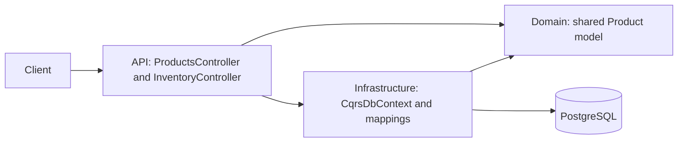
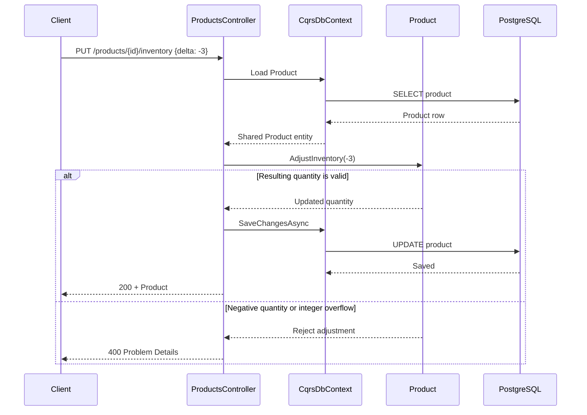

# CQRS — Product Catalog & Inventory

**Status: Work in Progress.** M1 through M3 are complete. **CQRS is not implemented yet.** The running shared-model application now includes an inventory dashboard; M4 and later milestones remain planned. See [PLAN.md](PLAN.md).

## The Problem

A small catalog tracks each product's ID, name, price, and available quantity. Users can list products, inspect one product, change its price, and adjust its inventory by a signed delta.

The warehouse operator also needs to know how many products exist, how many are out of stock or low on stock, the total inventory value, and which products need attention. These questions introduce counts, aggregations, calculated values, classifications, and sorting. They do not add write-side business behavior.

The write model protects business invariants, while the dashboard needs a read-optimized representation. CQRS allows these responsibilities to evolve independently when the complexity justifies the separation. It does not require separate databases or automatically improve performance: performance depends on the actual query design. The shared model still works correctly for this small catalog.

## Shared Model

Both reads and writes use the same `Product` entity and the same `CqrsDbContext`. Controllers load entities directly through EF Core. Write request DTOs contain `price` or `delta`; the existing product endpoints still return the shared Product model. Returning the entity directly is an intentional M2 exception to the repository's usual response DTO convention. The dashboard adds small HTTP response contracts because an aggregate dashboard cannot be represented by one Product. These contracts are not a dedicated CQRS query model. There are no command/query handlers, query services, read repositories, or separate read contexts.

Domain methods enforce these rules:

- Names cannot be null, empty, or whitespace.
- Prices cannot be negative; zero is allowed.
- Inventory cannot be negative; zero is allowed. Adjustments also reject integer overflow.

`UpdatePrice` and `AdjustInventory` enforce the rules before mutation. The controller handles HTTP concerns and saving; business rules live in Domain. `ILogger<T>` provides application logging.

`InventoryController` makes one `AsNoTracking().ToListAsync(cancellationToken)` call to load persisted Product entities, then calculates the dashboard in application memory:

```text
Load Product entities
      ↓
Calculate dashboard values
      ↓
Return dashboard response
```

The fixed dashboard classifications are mutually exclusive for valid product quantities:

| StockStatus | AvailableQuantity |
|---|---|
| `OutOfStock` | 0 |
| `LowStock` | 1 through 5 inclusive |
| `InStock` | Greater than 5 |

Each inventory value is `Price * AvailableQuantity`, using decimal arithmetic. The total sums these values across all products, including those in stock. Attention items include only out-of-stock and low-stock products, ordered by status (out of stock first), name ascending using ordinal comparison, then Product ID ascending for ties. `InStock` products contribute to the totals but do not appear in the attention list. Empty catalogs return zero counts/value and an empty list. Stock status, inventory value, and attention flags are not added to Product or persisted; no migration is needed.

## Solution and architecture

```text
EngineeringPlayground.Cqrs.sln
src/
  EngineeringPlayground.Cqrs.Api/             Controllers, HTTP requests/responses, startup
  EngineeringPlayground.Cqrs.Domain/          Product and its invariants
  EngineeringPlayground.Cqrs.Infrastructure/  DbContext, EF mapping, migrations
tests/
  EngineeringPlayground.Cqrs.IntegrationTests/ PostgreSQL HTTP tests and domain checks
```

Project references: API → Domain + Infrastructure; Infrastructure → Domain; IntegrationTests → API + Infrastructure. Domain has no project dependencies. There is no Application project or Worker.





An unknown product returns 404 before invoking a domain operation. Product reads use the same context and entity, returning Product directly.

The dashboard uses the same persistence path with an aggregate HTTP response:

```mermaid
sequenceDiagram
    participant Client
    participant Controller as InventoryController
    participant Context as CqrsDbContext
    participant DB as PostgreSQL
    Client->>Controller: GET /inventory/dashboard
    Controller->>Context: Products.AsNoTracking().ToListAsync()
    Context->>DB: SELECT products
    DB-->>Context: Product rows
    Context-->>Controller: Shared Product entities
    Note over Controller: Calculate counts, decimal values, classifications; sort attention items
    Controller-->>Client: 200 + InventoryDashboardResponse
```

## Run locally

Requirements: Docker with Linux containers and Docker Compose. From `06-cqrs/`:

```bash
docker compose up --build
```

This starts PostgreSQL 17 and the .NET 10 API at [http://localhost:8086/products](http://localhost:8086/products). PostgreSQL creates the database, its healthcheck gates API startup, and the API applies pending EF Core migrations before accepting requests. No manual database creation, migration command, or service sequencing is required.

Compose includes working local defaults. Optionally copy `.env.example` to `.env` to change `API_PORT`, `POSTGRES_DB`, `POSTGRES_USER`, or `POSTGRES_PASSWORD`. Credentials in the example are for local development. The database is internal to Compose; its data persists in a named volume. The local connection disables GSS encryption negotiation because this password-authenticated setup does not use Kerberos.

```bash
docker compose down
# To delete this PoC's local data and start fresh:
docker compose down -v
docker compose up --build
```

## Persistence, migrations, and seed

Infrastructure contains `CqrsDbContext`, `ProductConfiguration : IEntityTypeConfiguration<Product>`, and the generated `InitialCreate` migration. Mapping defines the primary key, required name, `numeric(18,2)` price, and integer quantity. Use currency values with at most two decimal places; PostgreSQL stores prices at that scale.

The initial migration inserts deterministic data through EF Core `HasData`:

| ID | Name | Price | AvailableQuantity |
|---|---|---:|---:|
| `11111111-1111-1111-1111-111111111111` | Mechanical Keyboard | 299.00 | 15 |
| `22222222-2222-2222-2222-222222222222` | Wireless Mouse | 129.00 | 30 |
| `33333333-3333-3333-3333-333333333333` | USB-C Dock | 449.00 | 8 |

Migration history prevents repeated startup from inserting duplicates or resetting edited values. `EnsureCreated()` is not used.

Only the API runs migrations, and only when the environment is **not Production**. Compose sets `ASPNETCORE_ENVIRONMENT=Development`. **Production never migrates automatically**: apply reviewed EF Core migrations through a controlled deployment process before starting the API. Configure `ConnectionStrings__Cqrs` for the target database. This PoC does not add a production migration runner.

## API

| Method | Endpoint | Behavior |
|---|---|---|
| GET | `/products` | 200, all products ordered by name |
| GET | `/products/{id}` | 200, one product; 404 if unknown |
| PUT | `/products/{id}/price` | `{ "price": 319.00 }`; 200 with updated Product |
| PUT | `/products/{id}/inventory` | `{ "delta": -3 }`; 200 with updated Product |
| GET | `/inventory/dashboard` | 200, counts, total inventory value, sorted attention items |

Both writes return 404 for an unknown product. Invalid or missing input returns 400; a rejected domain operation leaves persisted state unchanged. Positive deltas increase inventory and negative deltas decrease it.

```bash
curl http://localhost:8086/products
curl http://localhost:8086/products/11111111-1111-1111-1111-111111111111
curl -X PUT http://localhost:8086/products/11111111-1111-1111-1111-111111111111/price \
  -H "Content-Type: application/json" -d '{"price":319.00}'
curl -X PUT http://localhost:8086/products/11111111-1111-1111-1111-111111111111/inventory \
  -H "Content-Type: application/json" -d '{"delta":-3}'
```

The API project's `.http` file contains equivalent requests for an HTTP editor.

## Example Scenario

With a fresh database, the seeded products have quantities 15, 30, and 8, so none need attention. This request:

```bash
curl http://localhost:8086/inventory/dashboard
```

returns:

```json
{
  "totalProducts": 3,
  "outOfStockCount": 0,
  "lowStockCount": 0,
  "totalInventoryValue": 11947.00,
  "productsNeedingAttention": []
}
```

Starting from that seed, update the USB-C Dock price and reduce its inventory to the low-stock boundary:

```bash
curl -X PUT http://localhost:8086/products/33333333-3333-3333-3333-333333333333/price \
  -H "Content-Type: application/json" -d '{"price":459.00}'
curl -X PUT http://localhost:8086/products/33333333-3333-3333-3333-333333333333/inventory \
  -H "Content-Type: application/json" -d '{"delta":-3}'
curl http://localhost:8086/inventory/dashboard
```

The dashboard reads the persisted changes immediately:

```json
{
  "totalProducts": 3,
  "outOfStockCount": 0,
  "lowStockCount": 1,
  "totalInventoryValue": 10650.00,
  "productsNeedingAttention": [
    {
      "id": "33333333-3333-3333-3333-333333333333",
      "name": "USB-C Dock",
      "availableQuantity": 5,
      "stockStatus": "LowStock",
      "inventoryValue": 2295.00
    }
  ]
}
```

The total is `299.00 * 15 + 129.00 * 30 + 459.00 * 5 = 10650.00`. A further inventory adjustment of `-5` makes the dock `OutOfStock` with value zero. The existing domain methods protect valid price and quantity; the dashboard derives its presentation from that same state. JSON numbers may omit trailing zeros.

## Tests and validation

Install the .NET 10 SDK and start Docker. From `06-cqrs/`:

```bash
dotnet format
dotnet build
dotnet test
docker compose config
```

xUnit integration tests use `WebApplicationFactory` and Testcontainers with real PostgreSQL 17. Testcontainers creates and removes its own PostgreSQL container; Compose need not be running. Each test gets a new database, automatically migrated and seeded by API startup. Test data is deterministic and tests do not depend on order. Tests drop their databases, and the fixture disposes its container.

Coverage includes seeded reads, a single-product read, price persistence, positive/negative inventory adjustments, zero boundaries, rejected negative prices/inventory, overflow, missing request fields, unknown products, and repeatable migrations. Persistence assertions use a fresh DbContext. Additional checks cover invalid initial names, prices, and quantities, and Production startup without a database connection for migrations. No EF Core InMemory provider is used.

Dashboard tests replace the seeded products inside each test's own database. Actual HTTP requests verify explicit decimal totals at quantities 0, 1, 5, and 6; a zero-price item; attention membership, classifications, values, and ordering including same-name ID ties; price/inventory writes followed by fresh dashboard reads in all three stock categories; and an empty catalog. Existing M2 tests retain their seeded setup and assertions.

## Trade-offs and limits

The shared model keeps this application small and easy to trace, and loading Product entities for this dashboard is acceptable for a small catalog. Direct DbContext access couples controllers to persistence, and returning Product from the original endpoints couples their response shapes to the domain entity.

The dashboard makes a concrete read/write tension visible as the catalog grows:

- Full Product entities are loaded even though the dashboard does not need write behavior or every field for every result.
- Aggregation work and entity materialization consume application memory across the entire catalog.
- Read-specific calculations and sorting live alongside HTTP/application concerns.
- The read path remains coupled to the shared Product persistence model.

A dedicated query model with database projections could retrieve and aggregate just the required data, and separate those read concerns from writes. It is future work, not part of M3. The current implementation remains correct; CQRS is justified only when the complexity warrants the additional code, and query design determines performance.

Concurrency control is outside this PoC. Concurrent read-modify-save inventory adjustments can overwrite one another; this implementation is not safe against all concurrent inventory changes. There are no concurrency tokens, locks, reservations, retries, caching, background workers, messaging, or separate databases.

## When to use this baseline

Use a shared model for a small catalog with straightforward reads and writes, where separating responsibilities would add code without clear benefit.

## When not to use this baseline

Reconsider the shared response/entity shape when presentation queries diverge from business behavior or whole-catalog materialization becomes costly. Do not use this baseline as a stock reservation system requiring correct concurrent allocation. CQRS separation and read projections remain future work in the plan.
