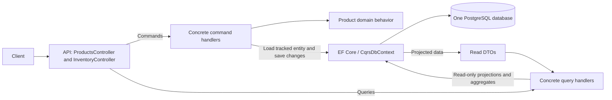
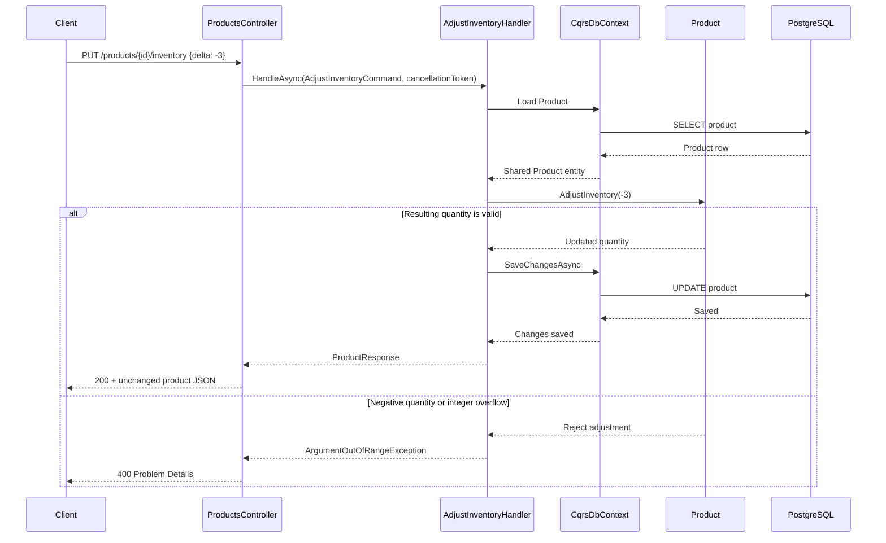
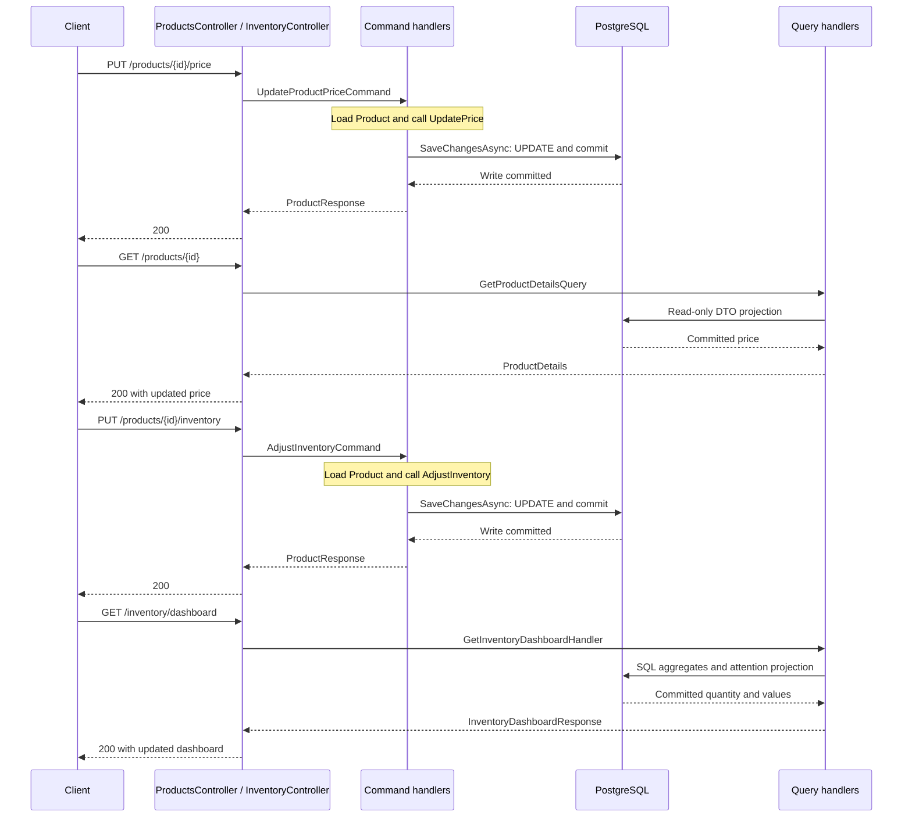
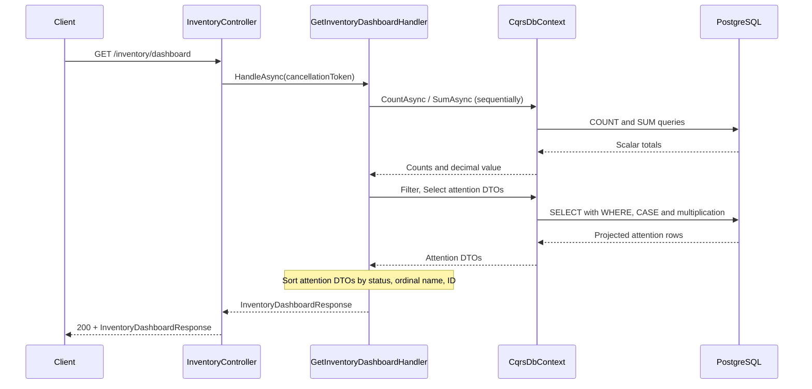

# CQRS — Product Catalog & Inventory

**Status: Work in Progress.** M1 through M6 are complete. Commands coordinate domain writes, and concrete query handlers return dedicated read DTOs through EF Core projections. M6 reviews these boundaries and verifies reads after each committed write. M7 and M8 remain planned. See [PLAN.md](PLAN.md).

## The Problem

A small catalog tracks each product's ID, name, price, and available quantity. Users can list products, inspect one product, change its price, and adjust its inventory by a signed delta.

The warehouse operator also needs to know how many products exist, how many are out of stock or low on stock, the total inventory value, and which products need attention. These questions introduce counts, aggregations, calculated values, classifications, and sorting. They do not add write-side business behavior.

The write model protects business invariants, while the dashboard needs a read-optimized representation. CQRS allows these responsibilities to evolve independently when the complexity justifies the separation. It does not require separate databases or automatically improve performance: performance depends on the actual query design. The shared model still works correctly for this small catalog.

## Domain model and read models

Both sides use the same `CqrsDbContext` and PostgreSQL database. `Product` remains the write-side domain entity. Write request DTOs contain `price` or `delta`; commands return the existing `ProductResponse`. Queries return `ProductListItem`, `ProductDetails`, and the existing `InventoryDashboardResponse` / `InventoryAttentionItemResponse` contracts. Product JSON still contains `id`, `name`, `price`, and `availableQuantity`; attention items retain `id` as the product identifier. Read DTOs expose data without domain behavior, and no query materializes Product entities.

Domain methods enforce these rules:

- Names cannot be null, empty, or whitespace.
- Prices cannot be negative; zero is allowed.
- Inventory cannot be negative; zero is allowed. Adjustments also reject integer overflow.

`UpdatePrice` and `AdjustInventory` enforce the rules before mutation. Controllers handle HTTP concerns; command handlers coordinate writes and saving; business rules live in Domain. Handlers retain structured write logging through `ILogger<T>`.

M3 demonstrated the shared-model problem by loading all Product entities and calculating the dashboard in the controller. M5 separates that responsibility:

```text
M3: Controller → Load Product entities → Calculate dashboard

M5: Controller → Query Handler → EF Core projections → Read DTO
```

The fixed dashboard classifications are mutually exclusive for valid product quantities:

| StockStatus | AvailableQuantity |
|---|---|
| `OutOfStock` | 0 |
| `LowStock` | 1 through 5 inclusive |
| `InStock` | Greater than 5 |

Each inventory value is `Price * AvailableQuantity`, using decimal arithmetic. The total sums these values across all products, including those in stock. Attention items include only out-of-stock and low-stock products, ordered by status (out of stock first), name ascending using ordinal comparison, then Product ID ascending for ties. `InStock` products contribute to the totals but do not appear in the attention list. Empty catalogs return zero counts/value and an empty list. Stock status, inventory value, and attention flags are not added to Product or persisted; no migration is needed.

## Command Side

A command represents an intention to change business state. `UpdateProductPriceCommand` carries a Product ID and the new price; `AdjustInventoryCommand` carries a Product ID and a signed quantity delta. Both are plain records independent of HTTP and EF Core types.

`ProductsController` constructs a command and calls its concrete `UpdateProductPriceHandler` or `AdjustInventoryHandler`, registered with scoped constructor injection. Each handler loads the Product through `CqrsDbContext`, invokes its domain method, calls `SaveChangesAsync`, and returns a small response DTO. A null result means the Product was not found. Cancellation flows from the controller through the handler to EF Core.

Controllers no longer coordinate write persistence. They map the handler result to the existing 200 response or 404, and domain validation exceptions to the existing 400 Problem Details. Missing request fields still receive 400 through request validation. Invariants remain in Product so every caller uses the same business rules; handlers do not duplicate them. Invalid domain operations fail before mutation or saving.

The write path remains unchanged from M4:

```text
Commands:
HTTP → Controller → Command Handler → Product → EF Core / PostgreSQL

Queries:
HTTP → Controller → Query Handler → EF Core / PostgreSQL → Read DTO
```

There is no dispatcher, handler interface, repository, or additional project. Command handlers do not depend on query handlers.

## M6 separation review

The existing handlers already keep write coordination and read presentation separate, so M6 retains their implementation and HTTP contracts. The two command handlers load tracked Product entities, invoke domain behavior, and save once before returning `ProductResponse`. The three query handlers use `AsNoTracking()`, project to consumer DTOs, and never mutate Product or save changes. Controllers map HTTP requests and results; Product alone enforces write invariants.

`ProductResponse` describes the existing command success response. `ProductListItem`, `ProductDetails`, `InventoryDashboardResponse`, and `InventoryAttentionItemResponse` describe query results. These records carry data without mutation methods, business invariants, or dependencies on commands. Dashboard DTOs remain in `Responses/`; product read DTOs live in `Queries/Models/`.

Commands and queries have no dependencies on one another. Both use the Infrastructure project's `CqrsDbContext` through scoped constructor injection, with a separate context instance per HTTP request. Domain has no EF Core or Infrastructure dependency: command handlers call domain methods and then persist the entity through Infrastructure. The shared database makes a subsequent request observe a completed prior write through ordinary queries; there is no separate read store to synchronize.

CQRS here means separating intentions to change state from requests for information. Direct calls to concrete handlers are sufficient; MediatR is an optional dispatch library, not a requirement. Event Sourcing is also independent: this application stores current Product state rather than reconstructing it from an event history.

## Query Side

`ProductsController` delegates GET requests to `GetProductsHandler` and `GetProductDetailsHandler`. The details operation takes a small `GetProductDetailsQuery(ProductId)` record and returns null for an unknown ID, which the controller maps to 404. List and dashboard handlers need only a cancellation token, so they do not introduce empty query records. All three concrete handlers are registered as scoped services and use constructor injection.

Product queries use `AsNoTracking()` and `Select` before asynchronous materialization. The list orders by Name then Id and projects directly to `ProductListItem`; details filters by ID and projects to `ProductDetails` in one query. Both read models contain only the existing four response fields. Domain entities are unnecessary for these presentation requests.

`InventoryController` delegates to `GetInventoryDashboardHandler`. PostgreSQL performs three `COUNT` queries (all products, quantity zero, quantity 1–5) and a decimal `SUM(Price * AvailableQuantity)`, defaulting an empty result to zero. A fifth query filters quantity <= 5 and projects directly to attention DTOs. SQL derives status with a conditional expression and calculates inventory value. The summary does not materialize catalog rows, and the attention projection does not select Price separately. Queries run sequentially because they share one scoped DbContext. Only the filtered attention DTOs are sorted in memory to preserve M3's exact .NET ordinal name ordering, including supplementary Unicode characters; PostgreSQL collations do not provide that UTF-16 ordering.

Read handlers never mutate entities or call `SaveChangesAsync`. A successful command commits to the same database that subsequent queries read, so committed changes are immediately observable without asynchronous projections. This is one application and one database, with separate responsibilities and no message broker, Event Sourcing, or eventual consistency requirement.

The concrete query changes reduce entity materialization and move filtering and aggregation into PostgreSQL. CQRS itself does not guarantee better performance; query shape, catalog size, and round trips determine the result. Read models can evolve for consumers without adding presentation fields or behavior to Product.

## Solution and architecture

```text
EngineeringPlayground.Cqrs.sln
src/
  EngineeringPlayground.Cqrs.Api/             Controllers, commands, queries, read/HTTP DTOs, startup
  EngineeringPlayground.Cqrs.Domain/          Product and its invariants
  EngineeringPlayground.Cqrs.Infrastructure/  DbContext, EF mapping, migrations
tests/
  EngineeringPlayground.Cqrs.IntegrationTests/ PostgreSQL HTTP tests and domain checks
```

Project references: API → Domain + Infrastructure; Infrastructure → Domain; IntegrationTests → API + Infrastructure. Domain has no project dependencies. There is no Application project or Worker.





For an unknown product the command handler returns null, and the controller returns 404 before any domain operation. Product reads use dedicated DTO projections through the same context type.

Read-after-write uses consecutive HTTP requests and the same PostgreSQL database:



No polling, delays, or asynchronous synchronization are needed. The command finishes saving before returning success, and the following query reads that committed state. CQRS does not inherently require eventual consistency.

The dashboard now executes database aggregates and a filtered projection:



## Run locally

Requirements: Docker with Linux containers and Docker Compose. From `06-cqrs/`:

```bash
docker compose up --build
```

This starts PostgreSQL 17 and the .NET 10 API at [http://localhost:8086/products](http://localhost:8086/products). PostgreSQL creates the database, its healthcheck gates API startup, and the API applies pending EF Core migrations before accepting requests. No manual database creation, migration command, or service sequencing is required.

Compose includes working local defaults. Optionally copy `.env.example` to `.env` to change `API_PORT`, `POSTGRES_DB`, `POSTGRES_USER`, or `POSTGRES_PASSWORD`. Credentials in the example are for local development. The database is internal to Compose; its data persists in a named volume. The local connection disables GSS encryption negotiation because this password-authenticated setup does not use Kerberos.

```bash
docker compose down
# To delete this PoC's local data and start fresh:
docker compose down -v
docker compose up --build
```

## Persistence, migrations, and seed

Infrastructure contains `CqrsDbContext`, `ProductConfiguration : IEntityTypeConfiguration<Product>`, and the generated `InitialCreate` migration. Mapping defines the primary key, required name, `numeric(18,2)` price, and integer quantity. Use currency values with at most two decimal places; PostgreSQL stores prices at that scale.

The initial migration inserts deterministic data through EF Core `HasData`:

| ID | Name | Price | AvailableQuantity |
|---|---|---:|---:|
| `11111111-1111-1111-1111-111111111111` | Mechanical Keyboard | 299.00 | 15 |
| `22222222-2222-2222-2222-222222222222` | Wireless Mouse | 129.00 | 30 |
| `33333333-3333-3333-3333-333333333333` | USB-C Dock | 449.00 | 8 |

Migration history prevents repeated startup from inserting duplicates or resetting edited values. `EnsureCreated()` is not used.

Only the API runs migrations, and only when the environment is **not Production**. Compose sets `ASPNETCORE_ENVIRONMENT=Development`. **Production never migrates automatically**: apply reviewed EF Core migrations through a controlled deployment process before starting the API. Configure `ConnectionStrings__Cqrs` for the target database. This PoC does not add a production migration runner.

## API

| Method | Endpoint | Behavior |
|---|---|---|
| GET | `/products` | 200, `ProductListItem` DTOs ordered by name then ID |
| GET | `/products/{id}` | 200, `ProductDetails` DTO; 404 if unknown |
| PUT | `/products/{id}/price` | `{ "price": 319.00 }`; 200 with updated product JSON (`ProductResponse`) |
| PUT | `/products/{id}/inventory` | `{ "delta": -3 }`; 200 with updated product JSON (`ProductResponse`) |
| GET | `/inventory/dashboard` | 200, counts, total inventory value, sorted attention items |

Both writes return 404 for an unknown product. Invalid or missing input returns 400; a rejected domain operation leaves persisted state unchanged. Positive deltas increase inventory and negative deltas decrease it.

```bash
curl http://localhost:8086/products
curl http://localhost:8086/products/11111111-1111-1111-1111-111111111111
curl -X PUT http://localhost:8086/products/11111111-1111-1111-1111-111111111111/price \
  -H "Content-Type: application/json" -d '{"price":319.00}'
curl -X PUT http://localhost:8086/products/11111111-1111-1111-1111-111111111111/inventory \
  -H "Content-Type: application/json" -d '{"delta":-3}'
```

The API project's `.http` file contains equivalent requests for an HTTP editor.

## Example Scenario

With a fresh database, the seeded products have quantities 15, 30, and 8, so none need attention. This request:

```bash
curl http://localhost:8086/inventory/dashboard
```

returns:

```json
{
  "totalProducts": 3,
  "outOfStockCount": 0,
  "lowStockCount": 0,
  "totalInventoryValue": 11947.00,
  "productsNeedingAttention": []
}
```

Starting from that seed, update the USB-C Dock price and reduce its inventory to the low-stock boundary:

```bash
curl -X PUT http://localhost:8086/products/33333333-3333-3333-3333-333333333333/price \
  -H "Content-Type: application/json" -d '{"price":459.00}'
curl -X PUT http://localhost:8086/products/33333333-3333-3333-3333-333333333333/inventory \
  -H "Content-Type: application/json" -d '{"delta":-3}'
curl http://localhost:8086/inventory/dashboard
```

The dashboard reads the persisted changes immediately:

```json
{
  "totalProducts": 3,
  "outOfStockCount": 0,
  "lowStockCount": 1,
  "totalInventoryValue": 10650.00,
  "productsNeedingAttention": [
    {
      "id": "33333333-3333-3333-3333-333333333333",
      "name": "USB-C Dock",
      "availableQuantity": 5,
      "stockStatus": "LowStock",
      "inventoryValue": 2295.00
    }
  ]
}
```

The total is `299.00 * 15 + 129.00 * 30 + 459.00 * 5 = 10650.00`. A further inventory adjustment of `-5` makes the dock `OutOfStock` with value zero. The existing domain methods protect valid price and quantity; the dashboard derives its presentation from that same state. JSON numbers may omit trailing zeros.

## Tests and validation

Install the .NET 10 SDK and start Docker. From `06-cqrs/`:

```bash
dotnet format
dotnet build
dotnet test
docker compose config
```

xUnit integration tests use `WebApplicationFactory` and Testcontainers with real PostgreSQL 17. Testcontainers creates and removes its own PostgreSQL container; Compose need not be running. Each test gets a new database, automatically migrated and seeded by API startup. Test data is deterministic and tests do not depend on order. Tests drop their databases, and the fixture disposes its container.

Coverage includes seeded reads, a single-product read, price persistence, positive/negative inventory adjustments, zero boundaries, rejected negative prices/inventory, overflow, missing request fields, unknown products, and repeatable migrations. The existing HTTP write tests now exercise command handlers and verify all product response fields and validation Problem Details. Persistence assertions use a fresh DbContext. Additional checks cover invalid initial names, prices, and quantities, and Production startup without a database connection for migrations. No EF Core InMemory provider is used.

Product HTTP tests verify complete list/detail DTOs, seeded list ordering, and same-name ID ties using deliberately scrambled insertion order. The unknown-product test retains the read 404 assertion. Dashboard tests replace the seeded products inside each test's own database. Actual HTTP requests verify explicit decimal totals at quantities 0, 1, 5, and 6; a zero-price item; attention membership, classifications, values, and ordering including same-name ID ties, case differences, and supplementary Unicode names; and an empty catalog. Read-after-write tests verify details and dashboard immediately after the price command, then again after the inventory command in all three stock categories. Each GET uses a separate HTTP request scope; a fresh DbContext also verifies the final persisted price and quantity. Write response tests deserialize `ProductResponse` rather than the domain entity, keeping HTTP contracts independent of domain behavior. Existing write and domain tests remain in place.

## Trade-offs and limits

Concrete command and query handlers add code in exchange for explicit responsibilities and thin controllers. Product queries are tailored to consumers while Product keeps write invariants. Handlers use DbContext directly because EF Core already provides the persistence/query operations this example needs. DTO projections still depend on the mapped schema and provider translation.

The benefits are clearer boundaries, domain protection of writes, consumer-specific read models, and the ability to evolve read and write code independently. The costs are additional classes and explicit structure, duplicated representations of some Product fields, and maintenance of separate read DTOs. The query improvements come from projections and SQL aggregation, which are also possible without CQRS; separation alone does not improve performance.

Compared with M3:

- Product entities are no longer materialized by reads.
- Database aggregates replace whole-catalog aggregation in application memory.
- Filtering and calculation happen before attention items are materialized; only projected attention DTOs are sorted in memory.
- Read-specific coordination lives in concrete handlers, outside HTTP mapping.

The dashboard deliberately uses five straightforward SQL queries rather than complex SQL to force one round trip. These statements do not provide a single snapshot if writes occur concurrently; a later read still sees a completed prior write. The attention list and product list are unbounded in this milestone. Exact compatibility with M3's ordinal sorting costs an in-memory sort of attention DTOs. No generic query abstraction or separate read store is needed here.

Concurrency control is outside this PoC. Concurrent read-modify-save inventory adjustments can overwrite one another; this implementation is not safe against all concurrent inventory changes. There are no concurrency tokens, locks, reservations, retries, caching, background workers, messaging, or separate databases.

## When to use this approach

Use concrete commands and queries when write intentions benefit from explicit coordination and presentation queries diverge from domain behavior.

Use database projections and aggregates when views need selected fields, derived values, or summaries without loading domain entities. One database keeps deployment and read-after-write behavior simple.

## When not to use this approach

Separate handlers may add little value for trivial CRUD with matching read/write needs. Do not use this example as a stock reservation system requiring correct concurrent allocation or a dashboard requiring a single consistent snapshot under concurrent writes. Separate read databases and asynchronous projections add costs that this catalog does not need. M7 and M8 remain future work in the plan.
