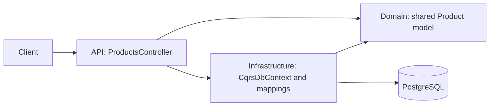
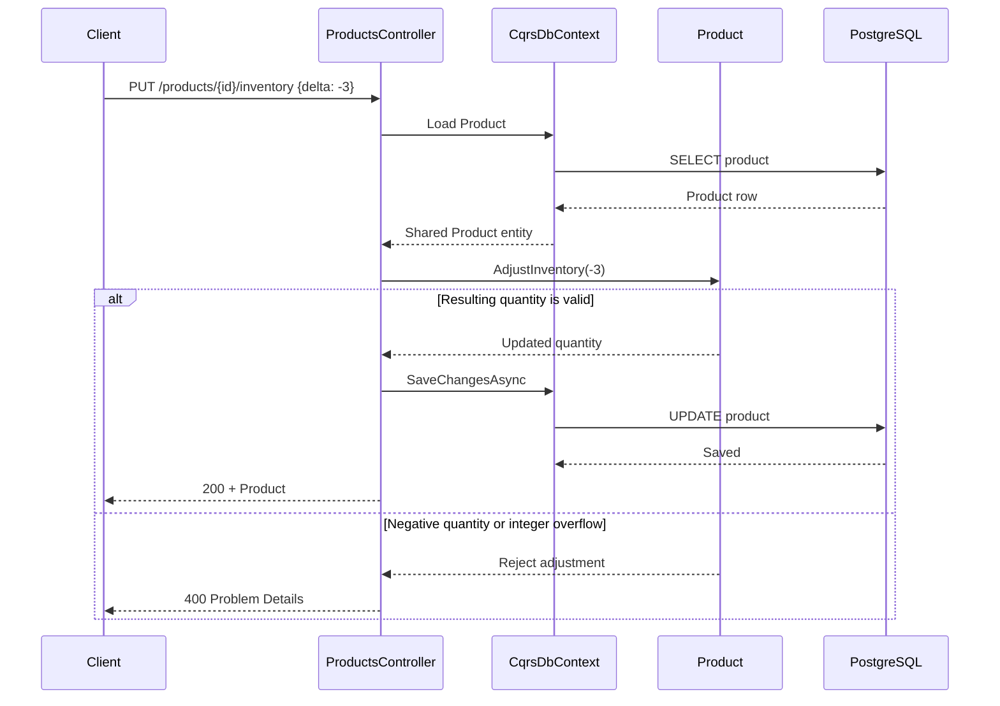

# CQRS — Product Catalog & Inventory

**Status: Work in Progress.** M1 and M2 are complete. **CQRS is not implemented yet.** This is a running shared-model baseline; M3 and later milestones remain planned. See [PLAN.md](PLAN.md).

## Scenario and motivation

A small catalog tracks each product's ID, name, price, and available quantity. Users can list products, inspect one product, change its price, and adjust its inventory by a signed delta.

Writes must preserve business rules, while reads currently need only the same four product fields. A single model is sufficient for this baseline. As presentation requirements diverge from business behavior, separate read and write responsibilities can become useful: that is the motivation for CQRS and the subject of later milestones. There is no inventory dashboard yet.

## Current implementation

Both reads and writes use the same `Product` entity and the same `CqrsDbContext`. Controllers load entities directly through EF Core. Write request DTOs contain `price` or `delta`; successful endpoints return the shared Product model. Returning the entity directly is an intentional M2 exception to the repository's usual response DTO convention. No dedicated read DTOs, services, repositories, or handlers have been introduced.

Domain methods enforce these rules:

- Names cannot be null, empty, or whitespace.
- Prices cannot be negative; zero is allowed.
- Inventory cannot be negative; zero is allowed. Adjustments also reject integer overflow.

`UpdatePrice` and `AdjustInventory` enforce the rules before mutation. The controller handles HTTP concerns and saving; business rules live in Domain. `ILogger<T>` provides application logging.

## Solution and architecture

```text
EngineeringPlayground.Cqrs.sln
src/
  EngineeringPlayground.Cqrs.Api/             Controllers, write requests, startup
  EngineeringPlayground.Cqrs.Domain/          Product and its invariants
  EngineeringPlayground.Cqrs.Infrastructure/  DbContext, EF mapping, migrations
tests/
  EngineeringPlayground.Cqrs.IntegrationTests/ PostgreSQL HTTP tests and domain checks
```

Project references: API → Domain + Infrastructure; Infrastructure → Domain; IntegrationTests → API + Infrastructure. Domain has no project dependencies. There is no Application project or Worker.





An unknown product returns 404 before invoking a domain operation. Reads use the same context and entity, returning Product directly.

## Run locally

Requirements: Docker with Linux containers and Docker Compose. From `06-cqrs/`:

```bash
docker compose up --build
```

This starts PostgreSQL 17 and the .NET 10 API at [http://localhost:8086/products](http://localhost:8086/products). PostgreSQL creates the database, its healthcheck gates API startup, and the API applies pending EF Core migrations before accepting requests. No manual database creation, migration command, or service sequencing is required.

Compose includes working local defaults. Optionally copy `.env.example` to `.env` to change `API_PORT`, `POSTGRES_DB`, `POSTGRES_USER`, or `POSTGRES_PASSWORD`. Credentials in the example are for local development. The database is internal to Compose; its data persists in a named volume. The local connection disables GSS encryption negotiation because this password-authenticated setup does not use Kerberos.

```bash
docker compose down
# To delete this PoC's local data and start fresh:
docker compose down -v
docker compose up --build
```

## Persistence, migrations, and seed

Infrastructure contains `CqrsDbContext`, `ProductConfiguration : IEntityTypeConfiguration<Product>`, and the generated `InitialCreate` migration. Mapping defines the primary key, required name, `numeric(18,2)` price, and integer quantity. Use currency values with at most two decimal places; PostgreSQL stores prices at that scale.

The initial migration inserts deterministic data through EF Core `HasData`:

| ID | Name | Price | AvailableQuantity |
|---|---|---:|---:|
| `11111111-1111-1111-1111-111111111111` | Mechanical Keyboard | 299.00 | 15 |
| `22222222-2222-2222-2222-222222222222` | Wireless Mouse | 129.00 | 30 |
| `33333333-3333-3333-3333-333333333333` | USB-C Dock | 449.00 | 8 |

Migration history prevents repeated startup from inserting duplicates or resetting edited values. `EnsureCreated()` is not used.

Only the API runs migrations, and only when the environment is **not Production**. Compose sets `ASPNETCORE_ENVIRONMENT=Development`. **Production never migrates automatically**: apply reviewed EF Core migrations through a controlled deployment process before starting the API. Configure `ConnectionStrings__Cqrs` for the target database. This PoC does not add a production migration runner.

## API

| Method | Endpoint | Behavior |
|---|---|---|
| GET | `/products` | 200, all products ordered by name |
| GET | `/products/{id}` | 200, one product; 404 if unknown |
| PUT | `/products/{id}/price` | `{ "price": 319.00 }`; 200 with updated Product |
| PUT | `/products/{id}/inventory` | `{ "delta": -3 }`; 200 with updated Product |

Both writes return 404 for an unknown product. Invalid or missing input returns 400; a rejected domain operation leaves persisted state unchanged. Positive deltas increase inventory and negative deltas decrease it.

```bash
curl http://localhost:8086/products
curl http://localhost:8086/products/11111111-1111-1111-1111-111111111111
curl -X PUT http://localhost:8086/products/11111111-1111-1111-1111-111111111111/price \
  -H "Content-Type: application/json" -d '{"price":319.00}'
curl -X PUT http://localhost:8086/products/11111111-1111-1111-1111-111111111111/inventory \
  -H "Content-Type: application/json" -d '{"delta":-3}'
```

The API project's `.http` file contains equivalent requests for an HTTP editor.

## Tests and validation

Install the .NET 10 SDK and start Docker. From `06-cqrs/`:

```bash
dotnet format
dotnet build
dotnet test
docker compose config
```

xUnit integration tests use `WebApplicationFactory` and Testcontainers with real PostgreSQL 17. Testcontainers creates and removes its own PostgreSQL container; Compose need not be running. Each test gets a new database, automatically migrated and seeded by API startup. Test data is deterministic and tests do not depend on order. Tests drop their databases, and the fixture disposes its container.

Coverage includes seeded reads, a single-product read, price persistence, positive/negative inventory adjustments, zero boundaries, rejected negative prices/inventory, overflow, missing request fields, unknown products, and repeatable migrations. Persistence assertions use a fresh DbContext. Additional checks cover invalid initial names, prices, and quantities, and Production startup without a database connection for migrations. No EF Core InMemory provider is used.

## Trade-offs and limits

The shared model keeps this application small and easy to trace. Direct DbContext access couples controllers to persistence, and returning Product couples the API response shape to the domain entity. These are deliberate baseline choices, with no query projections or separate read model yet.

Concurrency control is outside this PoC. Concurrent read-modify-save inventory adjustments can overwrite one another; this implementation is not safe against all concurrent inventory changes. There are no concurrency tokens, locks, reservations, retries, caching, background workers, messaging, or separate databases.

## When to use this baseline

Use a shared model for a small catalog with straightforward reads and writes, where separating responsibilities would add code without clear benefit.

## When not to use this baseline

Reconsider the shared response/entity shape when presentation queries diverge from business behavior. Do not use this baseline as a stock reservation system requiring correct concurrent allocation. CQRS separation, read projections, and the dashboard remain future work in the plan.
