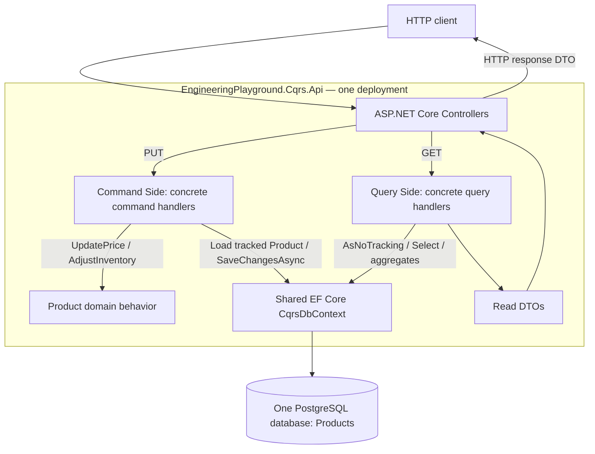

# CQRS architecture

Runtime responsibilities inside one API process:

`Product` is defined in **EngineeringPlayground.Cqrs.Domain**. The handlers use its behavior inside the API process; Domain has no project dependencies. **EngineeringPlayground.Cqrs.Infrastructure** defines `CqrsDbContext`, entity configuration, and migrations and depends on Domain. **EngineeringPlayground.Cqrs.Api** references both projects. Arrows above show runtime calls and data flow, not project dependencies: Product does not depend on EF Core.

Both sides use the same persistence infrastructure and table. Commands save domain state; queries project DTOs directly from that state without materializing Product entities. Read DTOs are response representations, not a separately stored read database. No broker, asynchronous synchronization, or independently deployed read/write services are involved.
