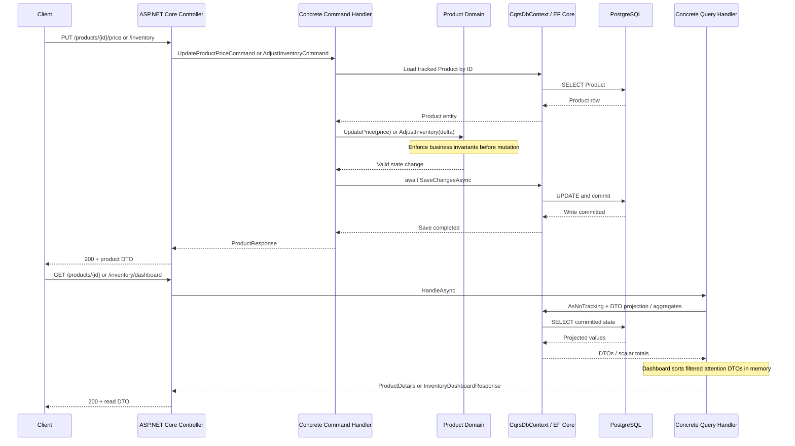

# Command-to-query flow

One successful update followed by a separate read request:

The command awaits the save before returning success. A subsequent ordinary query reads committed data from the same database under normal transaction semantics; no asynchronous projection update is needed. The dashboard executes five sequential SQL statements, so concurrent writes between statements can affect its internal consistency. Unknown products return 404; invalid command input returns 400 without saving.
